<div align="center">

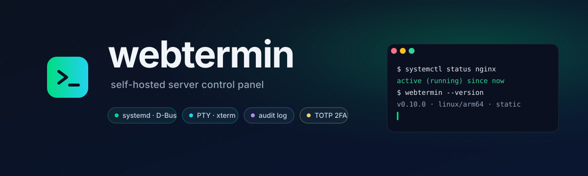

<h3>Красивая, безопасная, self-hosted альтернатива Webmin для управления одним Linux-сервером.</h3>

[](https://github.com/Satan1an/webtermin/actions/workflows/ci.yml)
[](https://github.com/Satan1an/webtermin/releases/latest)
[](LICENSE)
[](https://go.dev)
[](#установка)

🌐 **[English](README.md)** · **Русский**

</div>

---

**webtermin** — один статический Go-бинарник со встроенным React-фронтом. Из коробки работает только по HTTPS, проводит вас через создание администратора при первом запуске, использует пароли Argon2id, поддерживает TOTP 2FA, защищён CSRF-токенами и пишет полный аудит-лог. Каждое системное действие проходит через типизированный allowlist — **никаких shell-строк из пользовательского ввода, никогда**.

## Главное

| | |
|---|---|
| ⚡ **Один бинарник** | Статический Go-исполняемый файл (~14 МБ) с встроенной React-SPA через `go:embed`. Без runtime, без отдельного веб-сервера для статики. Один и тот же бинарник в `.deb` / `.rpm` / `.apk`. |
| 🔐 **Безопасность в основе** | TLS по умолчанию · Argon2id · HttpOnly/Secure/Strict cookies · CSRF-токены · строгий CSP · rate-limit + lockout · опциональная TOTP 2FA · RBAC (viewer / operator / admin) · API-токены со scope'ами · OIDC SSO. |
| 🤖 **ИИ-агенты — безопасно** | MCP-эндпоинт: Claude Code, Cursor и другие получают типизированные инструменты в рамках роли токена вместо root-шелла, каждый вызов в аудите. Пока только чтение; изменения будут требовать одобрения, которое агент не может дать сам. [docs/mcp.md](docs/mcp.md) |
| 📦 **Не убьёт систему** | Установка пакетов — сначала пробный прогон, проверки и подтверждение. Ключевые пакеты, работающее ядро, загрузчик и активный сетевой стек не удаляются никогда — [как это устроено](#безопасность-пакетов). |
| 📜 **Аудит-лог** | Каждое изменяющее действие записывается в SQLite — кто, что, когда, цель, результат, IP. Доступен в UI на странице `/audit`. |
| 🧩 **13 модулей** | См. [docs/modules.md](docs/modules.md). Systemd · Docker (Portainer-grade) · Compose stacks · cron · Linux-пользователи + SSH-ключи · файлы (Monaco) · PTY-терминал · пакеты (apt/dnf, пробный прогон) · firewall (ufw) · сеть (nmcli) · WireGuard · бэкапы · юзеры и токены панели. |
| 🎨 **Современный UI** | React + Tailwind + shadcn/Radix · recharts · Framer Motion · тёмная тема по умолчанию · адаптивный. |
| 🏗️ **ARM-ready** | Кросс-компиляция под `linux/amd64` и `linux/arm64` (OrangePi, Raspberry Pi 4/5, ARM cloud VMs). |
| 📚 **Документировано** | Per-module reference, полный API, OIDC + non-root walkthrough'и, гайд для контрибьюторов — всё в [`docs/`](docs/). |

## Скриншоты

<p align="center">
  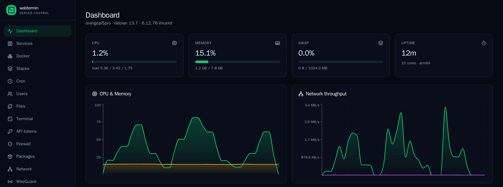
</p>

<table>
<tr>
<td width="50%">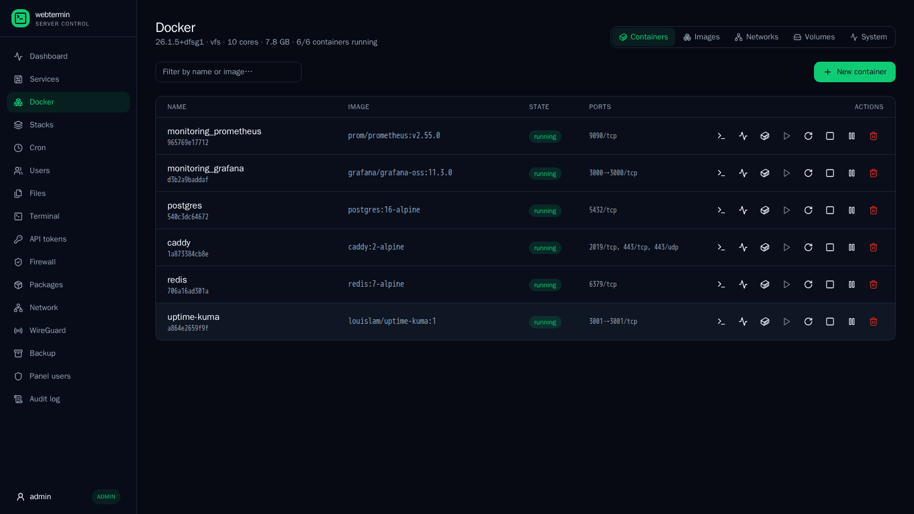<br><sub><b>Docker</b> — контейнеры, образы, сети, тома, exec, логи</sub></td>
<td width="50%">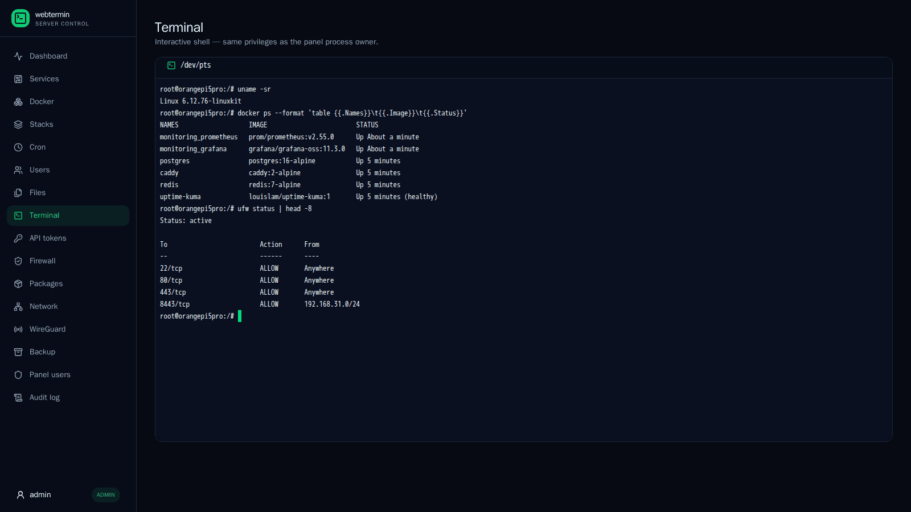<br><sub><b>Терминал</b> — PTY через WebSocket, от сопоставленного Linux-пользователя</sub></td>
</tr>
<tr>
<td>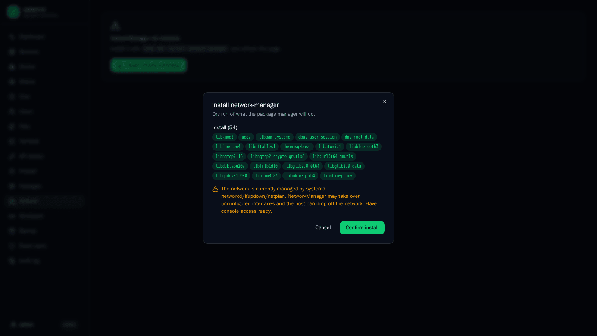<br><sub><b>Пакеты</b> — любая установка сначала прогоняется вхолостую</sub></td>
<td>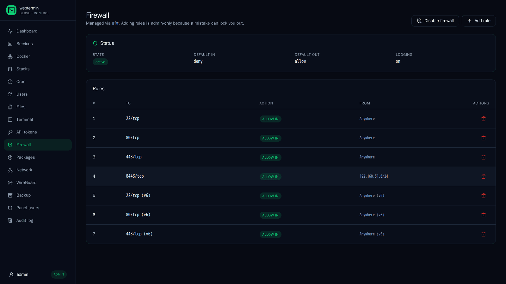<br><sub><b>Firewall</b> — статус и правила ufw</sub></td>
</tr>
<tr>
<td>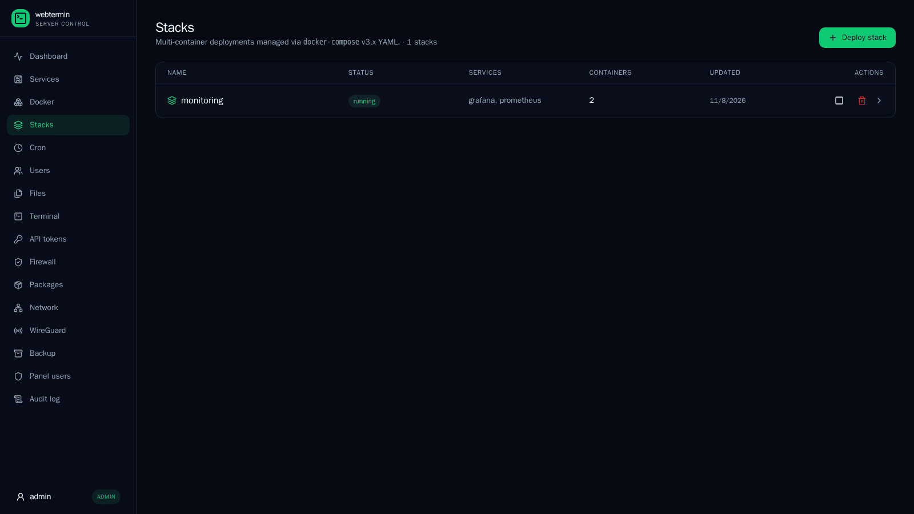<br><sub><b>Стеки</b> — деплой через Compose</sub></td>
<td>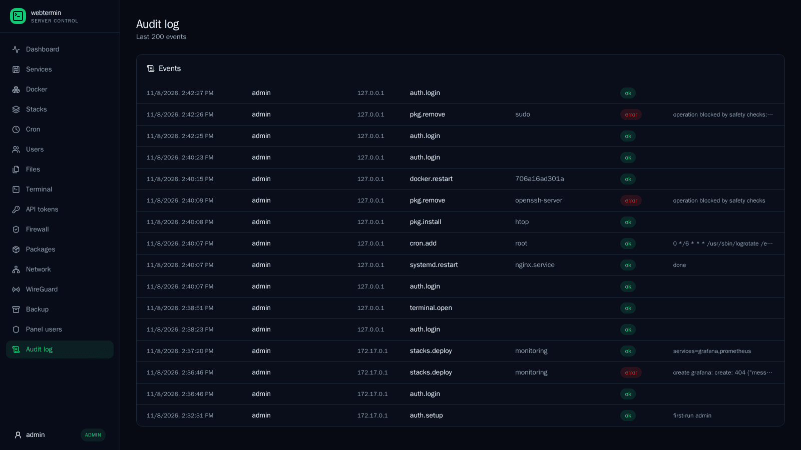<br><sub><b>Аудит</b> — все действия, включая отклонённые</sub></td>
</tr>
<tr>
<td>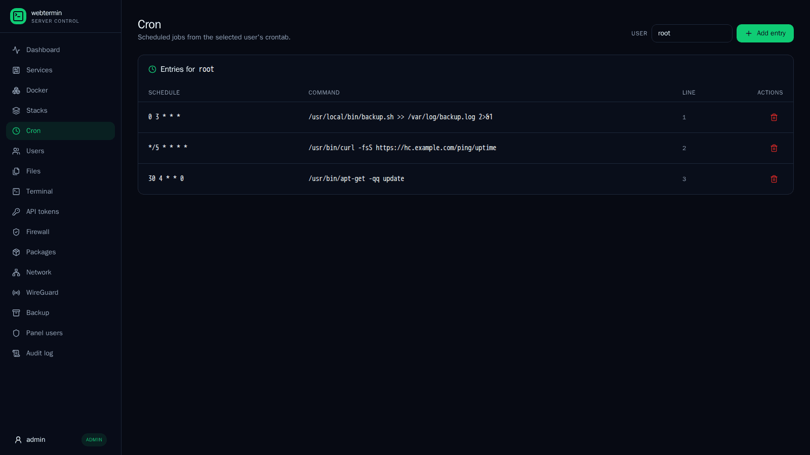<br><sub><b>Cron</b> — crontab по пользователям</sub></td>
<td>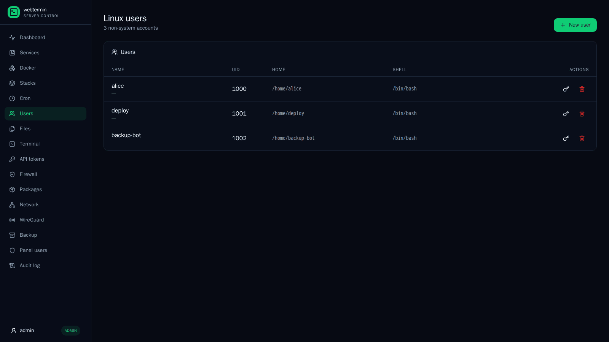<br><sub><b>Пользователи</b> — Linux-аккаунты и SSH-ключи</sub></td>
</tr>
</table>

## Как это устроено

<p align="center">
  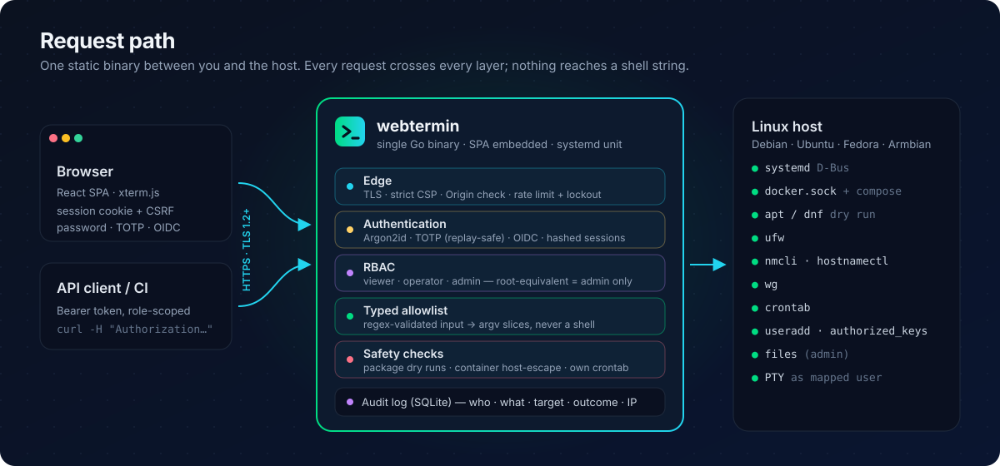
</p>

## Установка

### Debian / Ubuntu / OrangePi / Raspberry Pi — APT-репозиторий

Обновления приходят через `apt upgrade`, как у любого пакета:

```bash
sudo install -d -m 0755 /etc/apt/keyrings
curl -fsSL https://satan1an.github.io/webtermin/webtermin.gpg | sudo tee /etc/apt/keyrings/webtermin.gpg >/dev/null
sudo tee /etc/apt/sources.list.d/webtermin.sources >/dev/null <<'EOF'
Types: deb
URIs: https://satan1an.github.io/webtermin
Suites: stable
Components: main
Signed-By: /etc/apt/keyrings/webtermin.gpg
EOF
sudo apt update && sudo apt install webtermin
```

Подробности, откат версии и unattended-upgrades — в [docs/apt-repo.md](docs/apt-repo.md).

### Отдельный .deb

Скачайте пакет под свою архитектуру из [последнего релиза](https://github.com/Satan1an/webtermin/releases/latest):

```bash
# Тег последнего релиза; ARCH определится автоматически: amd64 или arm64.
VERSION=$(curl -fsSL https://api.github.com/repos/Satan1an/webtermin/releases/latest \
  | sed -n 's/.*"tag_name": *"v\([^"]*\)".*/\1/p')
ARCH=$(dpkg --print-architecture)
curl -fsSL -o webtermin.deb \
  "https://github.com/Satan1an/webtermin/releases/download/v${VERSION}/webtermin_${VERSION}_linux_${ARCH}.deb"
sudo apt install ./webtermin.deb
```

Пакет установит `webtermin` в `/usr/bin/`, положит systemd-юнит в `/lib/systemd/system/webtermin.service`, создаст `/var/lib/webtermin` для данных и `/etc/webtermin/config.yaml` как conffile (ваши правки сохраняются при обновлении) и запустит сервис.

Откройте **`https://<хост>:8443`**, чтобы пройти первоначальную настройку. Страница настройки попросит одноразовый **setup-токен** — чтобы свежую установку не успел занять кто-то другой. Токен пишется в журнал:

```bash
sudo journalctl -u webtermin | grep setup_token
```

### Почему нет Docker-образа?

webtermin управляет самим хостом — systemd, пользователями, пакетами, firewall, файлами. Контейнеру для этого нужны `privileged`, PID-namespace и файловая система хоста, то есть он ничего не изолирует, а каждому модулю пришлось бы дотягиваться до хоста. Ставьте нативно (`.deb` / `.rpm` / `.apk`). Модуль Docker — управление контейнерами на хосте — работает как обычно.

## Сборка из исходников

```bash
make build         # нативный бинарник для текущего хоста
make build-arm64   # кросс-компиляция aarch64 (OrangePi / RPi)
```

Требуется Go ≥ 1.26 и Node ≥ 22 (LTS).

## Конфигурация

Дефолтный конфиг лежит в `/etc/webtermin/config.yaml` (или `./config.yaml` при ручном запуске). Все параметры закомментированы в [`config.example.yaml`](config.example.yaml). Ключи, которые чаще всего хочется поменять:

| Ключ | По умолчанию | Комментарий |
| --- | --- | --- |
| `server.listen` | `0.0.0.0:8443` | Поставьте `127.0.0.1`, если впереди nginx/Caddy. |
| `server.tls_cert` / `tls_key` | _пусто_ | Пусто → self-signed cert генерируется в `data_dir/tls/`. Укажите путь к своим PEM для CA-выданного сертификата. |
| `data_dir` | `/var/lib/webtermin` | SQLite БД, сессии и автогенерированный TLS-cert. |
| `security.session_ttl_min` | `240` | Время жизни сессии в минутах. |
| `security.require_2fa` | `false` | Принудительно требовать TOTP 2FA для всех. |
| `security.max_login_attempts` | `5` | Сколько неудачных попыток с одного IP до lockout'а. |
| `terminal.default_shell` | _пусто_ | Fallback-shell для веб-терминала. |

После правки: `sudo systemctl restart webtermin`.

### Уведомления в Telegram

Создайте бота через [@BotFather](https://t.me/BotFather), напишите ему любое сообщение, возьмите chat id из `https://api.telegram.org/bot<TOKEN>/getUpdates` и добавьте в конфиг:

```yaml
notify:
  telegram:
    bot_token: "123456:ABC…"
    chat_id: "123456789"
  events: []      # пусто = все: login, lockout, denied, reboot, setup, service_failed, disk, updates
  disk_pct: 90
```

Перезапустите webtermin и нажмите **Send test** на странице Audit.

## Документация

| | |
|---|---|
| **Справочник модулей** — [`docs/modules.md`](docs/modules.md) | Все модули: что делают, кто что может, namespace'ы в audit-логе. |
| **ИИ-агенты (MCP)** — [`docs/mcp.md`](docs/mcp.md) | Подключение Claude Code / Cursor, инструменты по ролям, модель безопасности. |
| **HTTP API** — [`docs/api.md`](docs/api.md) | Полный список endpoint'ов по модулям. Незаменимо если автоматизируешь через API-токены. |
| **Настройка OIDC SSO** — [`docs/oidc-setup.md`](docs/oidc-setup.md) | Конкретный walkthrough на примере Authentik. |
| **Запуск без root** — [`docs/non-root-setup.md`](docs/non-root-setup.md) | Рецепт через sudoers + docker-группу для least-privilege деплоя. |
| **Контрибьюторам** — [`docs/contributing.md`](docs/contributing.md) | Раскладка репо, build/test/lint, паттерн добавления нового модуля. |

## Модель безопасности

- **Транспорт** — только HTTPS, TLS 1.2+, HSTS 2 года, X-Frame-Options DENY, строгий Content-Security-Policy.
- **Аутентификация** — Argon2id (64 МиБ, t=2, p=2). Session ID 256-битный, случайный, в HttpOnly + Secure + SameSite=Strict cookie, в базе хранится только SHA-256 хэш. TOTP-код нельзя использовать повторно. Первичная настройка требует одноразовый токен из журнала. CSRF-токен обязателен на каждом изменяющем запросе. Опциональная TOTP 2FA на пользователя. Rate-limit + lockout при неудачных входах. RBAC с тремя иерархическими ролями. API-токены со scope'ами фиксируемыми на момент выпуска. Опциональный OIDC SSO.
- **Системные действия** — каждое действие живёт за типизированным allowlist'ом. Имена юнитов сверяются с `^[A-Za-z0-9@_.\-:\\]+\.(service|socket|...)$`, имена пользователей — с `^[a-z_][a-z0-9_-]{0,31}$`, пути файлов должны быть абсолютными, очищенными, без `..`. **Никаких shell-строк, собранных из пользовательского ввода** — `useradd`, `chpasswd`, `journalctl`, `ufw`, `wg`, `nmcli`, `apt-get` и т.п. вызываются через argv-слайс в `os/exec`.
- **Пакеты** — пробный прогон, проверки и явное подтверждение до запуска; см. [Безопасность пакетов](#безопасность-пакетов).
- **Аудит** — каждое изменяющее действие пишется в `audit_log` (пользователь, IP, действие, цель, результат, детали). Доступен в UI на `/audit`.
- **Процесс** — по умолчанию работает от root; для least-privilege деплоя см. [docs/non-root-setup.md](docs/non-root-setup.md). Hardening systemd-юнита: `ProtectKernelTunables=true`, `ProtectKernelModules=true`.

### Роли

<p align="center">
  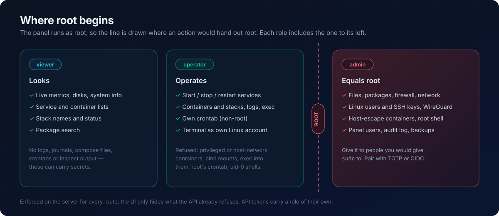
</p>

### Безопасность пакетов

<p align="center">
  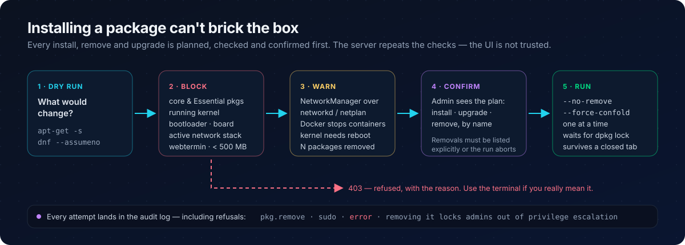
</p>

### История аудитов

Перед тегированием v0.1.0 (16.05.2026) был проведён ручной review + `govulncheck`: аудит `exec.Command` argv, параметризации SQL, режимов файлов, атрибутов cookie; глубокий разбор auth, CSRF, WebSocket origin, безопасности путей и выполнения команд. Результаты и by-design трейд-оффы — в [SECURITY.ru.md](SECURITY.ru.md#пре-релизный-аудит-v010--2026-05-16).

Каждый последующий релиз (v0.2 → v0.9) добавлял unit-тесты для валидаторов новых модулей. Второе полное ревью перед v0.10.0 (08.11.2026) закрыло захват первичной настройки, хранение сессий, повтор TOTP, root-эквивалентность в RBAC и выход контейнеров на хост — см. [SECURITY.ru.md](SECURITY.ru.md#ревью-безопасности-2026-11-08).

`go test -race`, `staticcheck`, `gosec` (HIGH), `govulncheck` и `gitleaks` гоняются на каждом CI-билде и раз в неделю.

Нашли уязвимость? См. [SECURITY.ru.md](SECURITY.ru.md).

## Когда что можно

| Сценарий | Можно? | Что нужно |
|---|---|---|
| Home-lab / NAS за роутером | ✅ да | Достаточно дефолтов |
| Сервер за Tailscale/WireGuard | ✅ да | Только клиенты с ключами могут даже увидеть :8443 |
| Локальный dev/test | ✅ да | `127.0.0.1` only |
| VPS с публичным IP | ⚠ осторожно | Reverse proxy + IP whitelist (или Cloudflare Access), 2FA обязательно, сложный пароль, fail2ban |
| Production с конфиденциальными данными | ❌ нет | Нет внешнего аудита, нет CVE-response процесса. Подождите v1.0 |
| Голый порт 8443 в интернет | ❌ нет | Даже с 2FA — слишком высокий риск 0day |

Подробнее в [SECURITY.ru.md](SECURITY.ru.md#где-можно-запускать-webtermin).

## Roadmap

Изначальный roadmap v0.1 → v0.9 **завершён**. Что доехало:

- ✅ RBAC (viewer / operator / admin) с last-admin guard
- ✅ API-токены с фиксированной ролью на момент выпуска
- ✅ OIDC SSO (Authentik / Authelia / Keycloak / Auth0 / …)
- ✅ Cron, firewall (ufw), network (nmcli), WireGuard, пакеты (apt/dnf)
- ✅ Portainer-grade Docker + Compose stacks
- ✅ Бэкапы (`/etc/webtermin` + `/var/lib/webtermin` + custom paths в tar.gz)
- ✅ Non-root режим (sudoers + docker-группа)
- ✅ `.deb` / `.rpm` / `.apk` пакеты
- ✅ Русскоязычные README + SECURITY
- ✅ v0.10: исправления по ревью безопасности, установка недостающих утилит в один клик, проверки безопасности пакетов

Идеи post-1.0 (когда наберём пользовательский feedback):

- [ ] Backup по расписанию через systemd timers
- [ ] Wi-Fi управление (`nmcli dev wifi …`)
- [ ] 24-часовая история на дашборде (rrdtool-style)
- [ ] Email / webhook алерты на выбранные audit-события
- [ ] Compose: image build из `build:`, healthcheck, secrets
- [ ] Docker: registry credentials, events stream, content browser для volume

PR'ы приветствуются — см. [docs/contributing.md](docs/contributing.md). Перед началом нетривиальной работы заведите issue.

## Лицензия

[MIT](LICENSE) © 2026 Satan1an
